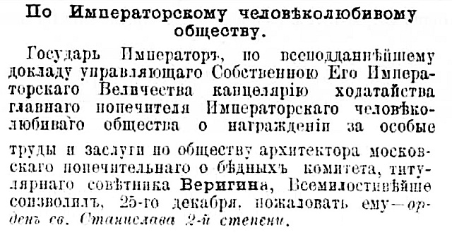

----

::: {.callout-warning title="Виктор Иванович Веригин"}
Проект в активной переработке. Страница не готова
:::

Действительный статский советник

Архитектор Московского попечительского комитета о бедных, Братолюбивого общества снабжения неимущих квартирами, Московского городского общества взаимного от огня страхования

Категория Единого Художественного Рейтинга С.В. Заграевского:
: **4В** — востребованный профессиональный архитектор

Дата рождения:
: 16 января 1845 г.

Место рождения:
: Российская империя, г. Москва

Дата смерти:
: 12 октября 1912 г. Некролог: «Московский листок» №237 от 16 октября 1912 г.

Место смерти:
: Российская империя, г. Москва

Место погребения:
: Российская империя, г. Москва, Миусское кладбище

Родители:
: [Иван Фёдорович Веригин (1814 – ?)](/Веригины/Иван_Фёдорович/)
: [Мария Ильинична Веригина (Хиньковская) (1823 – до 1854)](/Веригины/Мария_Ильинична/)

Братья и сестры:
: Николай Иванович Веригин (24.09.1841 – ?)
: Александра Ивановна Веригина (29.10.1842 – до 1844)
: Илья Иванович Веригин (05.11.1843 – 14.09.1862)
: Сергей Иванович Веригин (13.04.1846 – до 1847)
: [Алексей Иванович Веригин (10.03.1848 – 20.08.1915)](/Веригины/Алексей_Иванович)
: [Мария Ивановна Веригина (17.02.1850 – ?)](/Веригины/Мария_Ивановна/)
: Екатерина Ивановна Веригина (15.11.1852 – ?)

Супруг(а):
: Елизавета Самсоновна Веригина (дев. Иларионова) (30.08.1845 – 1920)

Дата венчания:
: 12 ноября 1872 г.

Дети:
: Мария Викторовна Веригина (21.05.1880 – 17.07.1882)
: Варвара Викторовна Швогер–Летецкая (дев. Веригина) (25.11.1875 – ?)
: Екатерина Викторовна Филиппович (дев. Веригина) (? – ?)

Генеалогическое древо:
: [Веригины](/Веригины/)

----

## Награды

Орден Святого Станислава, II степени

::: {.column-margin}
{height=157px}
:::

Дата:
: 25 декабря 1882 г.

Источник:
: «Неделя строителя», №2, 1883 г., стр. 13

----

## Образование

Поступил учиться в Московском дворцовом архитектурном училище (МДАУ). В связи с вхождением МДАУ в состав Московского училища живописи, ваяния и зодчества (МУЖВЗ), с 1865 года  учится в МУЖВЗ. В 1870 году после окончания которого, получил звание классного художника архитектуры.

## Братолюбивое общество

Вступил в Общество в 20 ноября 1873 года.

С 22 апреля 1903 года становится Почётным Членом Общества.

Согласно отчету Общества 20 ноября 1903 года «Комитет и некоторые Члены Братолюбивого общества чествовали в квартире и.о. Помощника Председательницы А.К. фон-Мекк Почётного Члена В.И. Веригина по случаю 30-летней полезной деятельности его по Братолюбивому Обществу и на память об этом событии поднесли ему от себя памятный жетон».

В отчете Общества за 1912 год по случаю кончины Виктора Ивановича была слелана следующая запись «Почётный Член, Действительный Статский Советник В.И. Веригин – один из старейших деятелей Общества, хорошо известен многим его членам, как сердечный человек и опытный архитектор. Почти все сколько нибудь крупные вопросы, возникавшие в жизни Общества, разрешались при его ближайшем участии, в особенности – строительные. Многие деревянные дома Мариинского Благотворительного Приюта построены усопшим В.И. Веригиным, состоявшим в Обществе около 40 лет».

## Список работ

### 1870

Адрес былой:
: Москва, Мещанская слобода

Адрес современный:
: Москва, Протопоповский переулок

Описание:
: 11 деревянных домов, в которых размещались дешевые квартиры для нуждающихся

Владелец/заказчик:
: Братолюбивое Общество в лице Председательницы княгини Надежды Борисовны.Трубецкой

Источник:
: Годовой отчет Братолюбивого общества снабжения в Москве неимущих квартирами за 1912 год. - Москва, типография В.И. Воронова. 1913. – с.27 – 355 с.

### 1876

Адрес былой:
: Москва, Савеловский пер., 9

Адрес современный:
: Москва, Пожарский, 9

Описание:
: Домовая церковь Иконы Божией Матери Всех Скорбящих Радость при Стрекаловской (бывшей Троицкой) больнице

Источник:
: Зодчие Москвы времени эклектики, модерна и неоклассицизма (1830-е — 1917 годы): илл. биогр. словарь / Гос. науч.-исслед. музей архитектуры им. А.В.Щусева и др. — М.: КРАБиК, 1998. — С. 57-58. — 320 с. — ISBN 5-900395-17-0

Подробнее о храме:
: «Храмы России», Церковь Иконы Божией Матери Всех Скорбящих Радость при Троицкой больнице

### 1877

Адрес былой:

Адрес современный:
: Москва, М. Златоустинский, 4

Описание:
: Дом Императорского человеколюбивого общества. Приют для детей воинов

Источник:
: Зодчие Москвы времени эклектики, модерна и неоклассицизма (1830-е — 1917 годы): илл. биогр. словарь / Гос. науч.-исслед. музей архитектуры им. А.В.Щусева и др. — М.: КРАБиК, 1998. — С. 57-58. — 320 с. — ISBN 5-900395-17-0

### 1880

Адрес былой:
: Московская губ., Клинский у., пог. Боголепова Пустынь

Адрес современный:
: Московская обл., Клинский р-н, ур. Боголепова Пустынь (1 км от д. Высоково)

Описание:
: Северный придел церкви Успения Пресвятой Богородицы в Боголеповой Пустыни

Источник:
: Зодчие Москвы времени эклектики, модерна и неоклассицизма (1830-е — 1917 годы): илл. биогр. словарь / Гос. науч.-исслед. музей архитектуры им. А.В.Щусева и др. — М.: КРАБиК, 1998. — С. 57-58. — 320 с. — ISBN 5-900395-17-0

Подробнее о храме:
: «Храмы России», Церковь Успения Пресвятой Богородицы в Боголеповой Пустыни

### 1881

Адрес былой:
: Москва, Калитниковское кладбище

Адрес современный:
: Москва, пер. Б. Калитниковский, 11. Калитниковское кладбище

Описание:
: Ризница церкви Иконы Божией Матери Всех Скорбящих Радость

Источник:
: Зодчие Москвы времени эклектики, модерна и неоклассицизма (1830-е — 1917 годы): илл. биогр. словарь / Гос. науч.-исслед. музей архитектуры им. А.В.Щусева и др. — М.: КРАБиК, 1998. — С. 57-58. — 320 с. — ISBN 5-900395-17-0

Подробнее о храме:
: «Храмы России», Церковь Иконы Божией Матери Всех Скорбящих Радость на Калитниковском кладбище

----

Адрес былой:
: Москва, ул. Мясницкая, 39

Адрес современный:
:  Москва, ул. Мясницкая, [перед д. 39]

Описание:
: Придел церкви Николая Чудотворца, что в Мясниках

Источник:
: Зодчие Москвы времени эклектики, модерна и неоклассицизма (1830-е — 1917 годы): илл. биогр. словарь / Гос. науч.-исслед. музей архитектуры им. А.В.Щусева и др. — М.: КРАБиК, 1998. — С. 57-58. — 320 с. — ISBN 5-900395-17-0

Подробнее о храме:
: «Храмы России», Церковь Николая Чудотворца, что в Мясниках

----

Адрес былой:
: Басманная ч., Сыромятническая ул. и Сыромятнические пер., уч. 635

Адрес современный:
:

Описание:
: Новый деревянный 2-х этажный дом, с такою же нежилой пристройкой

Владелец/заказчик:
: Полисадова Е.Н.

Источник:
: «Неделя строителя» №15-16, 1881 г., стр. 101

----

Адрес былой:
: Городская ч., ул. Ильинка, 102, 103 и 104, Никольская ул. и Богоявленский пер. 52

Адрес современный:
:

Описание:
: Надстройка третьего каменного этажа

Владелец/заказчик:
: Григорьев И.С.

Источник:
: «Неделя строителя» №20, 1881 г., стр. 132

----

Адрес былой:
: Городская ч., ул. Ильинка, 1 и 2

Адрес современный:
:

Описание:
: Устройство свода и духовой печи в подвале каменного 2-х этажного дома с палатками лавки

Владелец/заказчик:
: Горюнов И.Н.

Источник:
: «Неделя строителя» №27, 1881 г., стр. 186

----

Адрес былой:
: Городская ч., ул. Ильинка и Серебряный и Панской ряды, уч.: 616, 615, 620, 621

Адрес современный:
:

Описание:
: Капитальное исправление каменных одноэтажных с подвалами и палатками лавок и настройка на них вторых палаток по Серебряному ряду

Владелец/заказчик:
: Решетников А.С. и Бунина А.К.

Источник:
: «Неделя строителя» №35, 1881 г., стр. 247

----

Адрес былой:
: Городская ч., ул. Ильинка и Верхний Зеркальный ряд, уч.: 155, 156 и 157

Адрес современный:
:

Описание:
: Устройство духовой печи в подвале каменной 3-хэтажной лавки, с покрытием его сводом

Владелец/заказчик:
: Беляев Ф.П.

Источник:
: «Неделя строителя» №39, 1881 г., стр. 277

----

Адрес былой:
: Мещанская ч., Докучаев пер., уч. 635/542

Адрес современный:
:

Описание:
: Деревянные одноэтажные погреба с каменными ямниками и сушильнею для белья

Владелец/заказчик:
: Народный учитель Александр Иванович Иванов

Источник:
: «Неделя строителя» №42, 1881 г., стр. 303

----

Адрес былой:
: Арбатская ч., Кречетниковский и Трубный пер., уч. 127

Адрес современный:
:

Описание:
: Надстройка второго деревянного жилого этажа на таких же службах

Владелец/заказчик:
: Муханов С.И.

Источник:
: «Неделя строителя» №48, 1881 г., стр. 342

### 1882

Адрес былой:
: Москва, Пресненская ч., Нижняя и Средняя пресни ул. и Глубокий и средний Никольский пер., уч. 200-1 (201/200)

Адрес современный:
: Верхний Предтеченский и Глубокий переулки и ул. Рочдельская

Владелец/заказчик:
: Фёдор Петрович Беляев

Описание:
: Каменный двухэтажный, частию с жилым подвалом, фабричный корпус с двумя металлическими лестницами и таким же сходом в подвал; исправление каменного одноэтажного фабричного корпуса, с перебивкою окон, надстройкою деревянного второго этажа и устройством двух металлических лестниц и каменного одноэтажного ретирада и жилая сторожка

Источник:
: «Неделя строителя» №6, 1882 г., стр. 43

----

Адрес былой:
: Москва, Мещанская ч., Докучаев пер., 13 (уч. 635/542)

Адрес современный:
:

Владелец/заказчик:
: Народный учитель Александр Иванович Иванов

Описание:
: Деревянный двухэтажный дом, частично на жилом подвале, с межевым брандмауэром, с деревянной одноэтажной сушильнею, службы

Источник:
: «Неделя строителя» №9, 1882 г., стр. 67

----

Адрес былой:
: Москва, Хамовническая ч., Девичье поле, Полуектовский и Долгий пер., уч. 205

Адрес современный:
: Москва, участок между домами 2 по пр. Девичьего поля и 6 по ул. Бурденко

Владелец/заказчик:
: Попечительский о бедных комитет Усачево-Чернявского училища

Описание:
: Каменный 2-х этажная жилая пристройка к такому же 3-х этажному флигелю

Источник:
: «Неделя строителя» №11, 1882 г., стр. 182

----

Адрес былой:
: Москва, Хамовническая ч., Девичье поле, Полуектовский и Долгий пер., уч. 205

Адрес современный:
: Москва, участок между домами 2 по пр. Девичьего поля и 6 по ул. Бурденко

Владелец/заказчик:
: Усачево-Чернявское училище

Описание:
: Деревянный 2-х этажный жилой флигель с межевым брандмаузром; каменный 2-х этажный, для парадной лестницы, пристройка к дому.

Источник:
: «Неделя строителя» №22, 1882 г., стр. 173

----

Адрес былой:
: Москва, Мещанская ч., 3-я Мещанская ул., уч. 221

Адрес современный:
: Москва, Щепкина, 1-3

Владелец/заказчик:
: купец 2-й гильдии Урин И.Г.

Описание:
: Смешанный 2-х этажный дом

Источник:
: «Неделя строителя» №24, 1882 г., стр. 190

----

Адрес былой:
: Москва, Городская ч., Грузинский пер., 3

Адрес современный:
: Москва, Никитников пер., 3

Описание:
: Причт церкви Грузинской Богоматери. Каменный одноэтажный, частично с подвалом, службы

Источник:
: «Неделя строителя» №25, 1882 г., стр. 198

Подробнее о храме:
: «Храмы России», Церковь Троицы Живоначальной, что в Никитниках

### 1883

Адрес былой:
: Москва, Хамовническая ч., Б. Вражский и Б.Благовещенский пер., (уч. 502/543)

Адрес современный:
: Москва, 1-й Вражский пер.., 18

Описание:
: Каменный трехэтажный дом

Владелец/заказчик:
: Веригина Юлия Сергеевна

Источник:
: «Неделя строителя» №42, 1883 г., стр. 323

### 1885

Адрес былой:
: Москва, ул. Гороховая, 23 (уч. 573/323)

Адрес современный:
: Москва, ул. Казакова, 23

Описание:
: Особняк

Владелец/заказчик:
: Бронницкий купцец 1-й гильдии Иван Никифорович Дёмин

Источник:
: Государственный Исторический Музей, спецпроект «Узнай Москву», «Усадьба купцов Дёминых»

### 1888 (1890?)

Адрес былой:
: Москва, Софийская наб., 32

Адрес современный:
: Москва, Софийская наб., 32, стр. 14

Описание:
: Перестройка трапезной с двумя приделами церкви Софии Премудрости Божией, что в Средних Садовниках

Источник:
: Зодчие Москвы времени эклектики, модерна и неоклассицизма (1830-е—1917 годы): илл. биогр. словарь / Гос. науч.-исслед. музей архитектуры им. А.В.Щусева и др. — М.: КРАБиК, 1998. — С. 57-58. — 320 с. — ISBN 5-900395-17-0

Подробнее о храме:
: «Храмы России», Церковь Софии Премудрости Божией, что в Средних Садовниках

### 1896

Адрес былой:
: Московская губ., Звенигородский у., с. Одинцово

Адрес современный:
: Московская обл., г. Одинцово, Можайское ш., 72

Описание:
: Пристройка трапезной и колокольни церкви Иконы Божией Матери Гребневская в Одинцово

Источник:
: Зодчие Москвы времени эклектики, модерна и неоклассицизма (1830-е—1917 годы): илл. биогр. словарь / Гос. науч.-исслед. музей архитектуры им. А.В.Щусева и др. — М.: КРАБиК, 1998. — С. 57-58. — 320 с. — ISBN 5-900395-17-0

Подробнее о храме:
: «Храмы России», Церковь Иконы Божией Матери Гребневская в Одинцово

### 1899

Адрес былой:
: Московская губ., Дмитровский у., с. Перемилово

Адрес современный:
: Московская обл., Дмитровский р-н, г. Яхрома, ул. Перемиловская, 93

Описание:
: Ограда церкви Вознесения Господня

Источник:
: Зодчие Москвы времени эклектики, модерна и неоклассицизма (1830-е—1917 годы): илл. биогр. словарь / Гос. науч.-исслед. музей архитектуры им. А.В.Щусева и др. — М.: КРАБиК, 1998. — С. 57-58. — 320 с. — ISBN 5-900395-17-0

Подробнее о храме:
: «Храмы России», Церковь Вознесения Господня в Перемилово

### 1903

Адрес былой:
: Москва, Городская ч., Грузинский пер., 3

Адрес современный:
: Москва, Никитников пер., 3

Описание:
: Придел в подклете церкви Троицы в Никитниках.

Источник: 
: Зодчие Москвы времени эклектики, модерна и неоклассицизма (1830-е—1917 годы): илл. биогр. словарь / Гос. науч.-исслед. музей архитектуры им. А.В.Щусева и др. — М.: КРАБиК, 1998. — С. 57-58. — 320 с. — ISBN 5-900395-17-0

Подробнее о храме:
: «Храмы России», Церковь Троицы Живоначальной, что в Никитниках

### 1906

Адрес былой:
: Москва, Пречистенская ч., Савельевский пер., уч. 61/60
Адрес современный:
: Москва, Пожарский пер., 11-13

Описание:
: Строительство одного каменного строения

Владелец:
: Н.П. Горбунов

Источник:
: Архитектурный и художественно-технический журнал «Зодчий», №13 от 26 марта 1906 г.

### 1907

Адрес былой:
: Москва, 1-я Мещанская ч., 2-й Спаский тупик, уч. 610/531 и 616/531

Адрес современный:
: Москва, ул. Большая Спасская, 10-12 (хотя может оказаться за д. 6, ищу карты)

Описание:
: Строительство трёх деревянных строений

Владелец:
: Виктор Иванович Веригин

Источник:
: Архитектурный и художественно-технический журнал «Зодчий», №43 от 28 октября 1907 г.

### 1908

Адрес былой:
: Москва, 1-я Рогожская ч., Брёхов пер., уч. 1663/614

Адрес современный:
: Москва, 4-й Котельнический пер., 3

Описание:
: Строительство двух каменных строений

Владелец:
: Купец (шелк и шелк-сырец) Александр Емельянович Нырнов

Источник:
: Архитектурный и художественно-технический журнал «Зодчий», №24 от 15 июня 1908 г.

----

Адрес былой:
: Москва, 1-я Рогожская ч., Гончарная наб., уч. 664/614

Адрес современный:
: Москва, Котельническая наб., 31

Описание:
: Строительство одного каменного строения

Владелец:
: Купец (шелк и шелк-сырец) Александр Емельянович Нырнов

Источник:
: Архитектурный и художественно-технический журнал «Зодчий», №32 от 10 августа 1908 г.

### 1909

Адрес былой:
: Москва, 1-я Рогожская  ч., Брёхов пер., уч. 664/614 (пишу, как есть, но в 1908 и по карте участок по Гончарной наб.)

Адрес современный:
: Москва, Котельническая наб., 31

Описание:
: Строительство одного каменного строения

Владелец:
: Купец (шелк и шелк-сырец) Александр Емельянович Нырнов

Источник:
: Архитектурный и художественно-технический журнал «Зодчий», №29 от 19 июля 1909 г.

### 1912

Адрес былой:
: Москва, 1-я Рогожская  ч., Брёхов пер., уч. 664/1667 (пишу, как есть, скорее всего, это объединённые участки 664/614 и 1663/614 или опечатка)

Адрес современный:
: Москва, от Котельнической наб., 31 до 4-го Котельнического пер., 3

Описание:
: Строительство одного каменного строения

Владелец:
: Купец (шелк и шелк-сырец) Александр Емельянович Нырнов

Источник:
: Архитектурный и художественно-технический журнал «Зодчий», №10 от 4 марта 1912 г.

Примечание: 
: Также в колонке «Подпись на проекте» указано «Вершин». Обратите внимание на оригинальную подпись Виктора Ивановича, можно прочитать и «Вершин», но в процессе просмотра я архитектора с оной фамилией не встречал. Таким образом, считая, что это, скорее всего, опечатка и гражданский заказчик опять же А.Е. Нырнов, коему Виктор Иванович строил четыре строения в 1908–1909 годах, причисляю запись к работам В.И. Веригина
