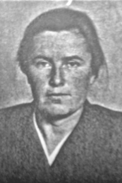
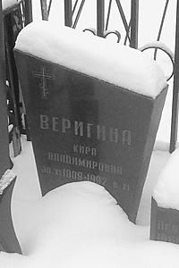
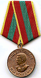
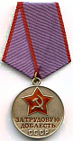

----

Дата рождения:
: 30.11.1909

Место рождения:
: Российская Империя, г. Москва

Дата смерти:
: 08.11.1992

Место смерти:
: Российская Федерация, г. Москва

Место погребения:
: Российская Федерация, г. Москва, Даниловское кладбище, уч. 29 (рег.№ 1867/1992)

Родители:
: [Владимир Алексеевич Веригин (1879-1929)](/Веригины/Владимир_Алексеевич)
: [Зинаида Александровна Веригина (Яфа) (1881-1943)](/Веригины/Зинаида_Александровна)

Братья и сестры:
: [Галина Владимировна Веригина (1908-1921)](/Веригины/Галина_Владимировна)

Супруг(а):
: Шумаков Владимир Сергеевич (разведены)

Дети:
: нет

Генеалогическое древо:
: [Веригины](/Веригины)

----

----

## Награды

Медаль «За оборону Москвы»

::: {.column-margin}
{height=157px}
:::

Медаль «За доблестный труд в Великой Отечественной Войне 1941-1945 гг.»

::: {.column-margin}
{height=157px}
:::

Медаль «За трудовую доблесть»

::: {.column-margin}
{height=157px}
:::

----

Кира Владимировна Веригина родилась в Москве 30 ноября 1909 года в семье потомственных дворян титулярного советника Владимира Алексеевича и Зинаиды Александровны Веригиных.

В 1927 году окончила 9-ю школу Московского отдела народного образования, а в 1929 году химспецкурсы при той же школе, получив специальность химик-лаборант.

С 1929 по 1934 годы работала в лаборатории почвоведения в Научном институте по удобрениям (НИУ) в качестве техника-аналитика и младшего почвоведа. За время работы принимала активное участие в обслуживании опытных станций Советского Союза.

С 1932 по 1936 годы обучалась на факультете агрохимии и почвоведения в Сельско-хозяйственной академии им. К.А.Тимирязева (ТСХА). 16 декабря 1936 года с оценкой “отлично” защитила дипломную работу на тему: “Состав органического вещества лесных почв”. Квалификационная комиссия под руководством В.Р.Вильямса вручили Кире Владимировне Веригиной диплом первой степени и присвоили квалификацию “агрохимик-почвовед”.

С января 1937 года является сотрудником Почвенного института АН СССР им. В.В.Докучаева.

В ноябре 1943 года Кира Владимировна защитила научную диссертацию на тему “Миграция железа при глееобразовании”, в результате чего ей присвоена ученая степень кандидат геолого-минералогических наук. А в январе 1945 года Президиумом Академии Наук ей присвоено звание старшего научного сотрудника лаборатории химии почв.

В Почвенном институте им. В.В.Докучаева Кира Владимировна работала над изучением форм фосфора, меди, цинка, кобальта и бора в почве; вопросов глееобразования и миграции железа в почве; над методическими вопросами составления крупномасштабных карт содержания в почве подвижных форм микроэлементов.

Разработала химические методы определения микроэлементов в почвах и растениях, уникальную методику озоления растительного материала при определении микроэлементов. Провела научные исследования по выявлению влияния процессов почвообразования на распределение микроэлементов в основных типах почв европейской части СССР и определила содержание микроэлементов в почвах Московской и Ярославской областей.

Кира Владимировна Веригина принимала активное участие во всесоюзных, межвузовских, зональных и других совещаниях и конференциях по микроэлементам. Выезжала в научные командировки в Швейцарию и Румынию. Также она активно участвовала в общественной жизни института, являясь секретарем комиссии “химии почв” Всесоюзного общества почвоведов.

Кира Владимировна опубликовала более 50 научных работ.

Кира Владимировна Веригина награждена правительственными наградами: медалями “За оборону Москвы”, “За доблестный труд в Великой Отечественной Войне 1941-1945 гг.” и “За трудовую доблесть”.

Скончалась Кира Владимировна в Москве 8 ноября 1992 года, похоронена на Даниловском кладбище.
